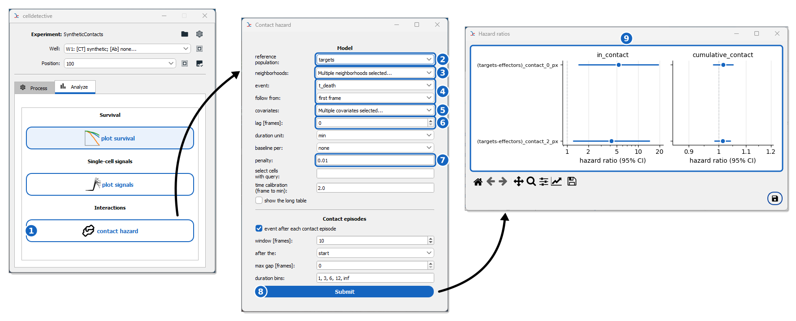
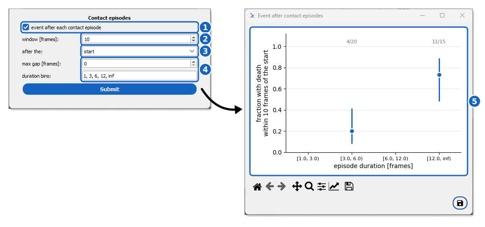

How to relate contacts and other quantities to an event with a hazard model
===========================================================================

This guide shows you how to test whether the contacts a cell receives (from
effector cells, say) raise the hazard of one of its events (its death, say),
and whether the answer depends on how a contact is defined. The same model
takes the measurements of the cells and the conditions of their wells (a
concentration, say), with or without contacts.

Reference keys: :term:`neighborhood`, :term:`mask contact`, :term:`contact episode`, :term:`hazard ratio`, :term:`survival`

**Prerequisite:**

*   The reference population (e.g. ``targets``) is tracked and has the event
    of interest: a ``t_death`` column with its ``class_death`` (``0`` the event
    happened, ``1`` it did not, ``2`` otherwise, e.g. a cell already dead when first seen),
    from :doc:`event detection <../basics/detect-an-event-with-conditions>` or
    :doc:`annotation <../basics/annotate-an-event>`.
*   At least one neighborhood between the reference and the neighbor
    population is computed (:doc:`../basics/measure-cell-interactions`), so
    that the table of the reference population has its
    ``inclusive_count_neighborhood_...`` columns. Several mask-contact
    distances let you check the robustness of the result.
*   For the analysis of contact episodes, the pairs of that neighborhood are
    measured (**MEASURE PAIRS**), which writes ``trajectories_pairs.csv``.

Why a hazard model with time-varying contacts
----------------------------------------------

The tempting analysis groups the cells by their total contact time and compares
the survival curves of the groups. It is biased in two ways:

*   **Immortal time.** A cell has to stay alive to accumulate contact, and a
    contact usually ends when the cell dies. Long-contacted cells then look
    protected, or the opposite, whatever the contacts do.
*   **Reverse causation.** Effectors may stay on, or be drawn to, cells that
    are already dying. Contact then goes with death without causing it.

The hazard model follows each cell frame by frame and relates the
hazard of the event at a time to the contacts the cell has received *before*
that time only. The result is a :term:`hazard ratio` per covariate: by how
much the instantaneous risk of the event is multiplied when the covariate
rises by one unit (one more neighbor, one more minute of contact). A ratio
whose 95% interval lies above 1 means a higher risk.

.. note::
    Images alone show association, not causation. To claim that the contacts
    *cause* the deaths, add evidence the model cannot give: a dose-response
    (the ratio grows with the contact time), a delay between contact and death
    that is consistent across cells, and above all perturbations in sister
    wells (blocking antibodies, inhibitors of the lytic machinery, a range of
    effector:target ratios, targets alone for the spontaneous death rate).
    Selecting these wells in the control panel and giving each its own baseline
    hazard (**baseline per** ``well``) compares them in one model.

Fit the model
-------------

    **Contact hazard of death.** Synthetic targets killed at random during
    their contacts with effectors: being in contact multiplies the hazard of
    death, at both contact distances, while the contact time accumulated
    before adds nothing.

#. Select the wells and positions to analyze in the control panel.

#. Go to the **Analyze** tab and click **hazard model**, under
   **Survival** (1).

#. Select the **reference population** (2). The populations with an event
   time (a ``t_*`` column) are offered.

#. Check one or more **neighborhoods** (3). The model is fitted once per
   neighborhood: with several contact distances, the forest plot shows
   whether the conclusion depends on the definition of a contact. A
   neighborhood is only needed for the contact covariates: without one, the
   model relates the event to the measurements of the cells and the
   conditions of the wells, e.g. whether the targets die faster at a higher
   concentration, from a single population.

#. Select the **event** (``t_death`` by default when it exists) (4).

#. Check the **covariates** (5); ``in_contact`` and ``cumulative_contact`` are
   checked by default:

   *   ``in_contact``: 1 when the cell has at least one neighbor, else 0;
   *   ``n_neighbors``: the number of neighbors;
   *   ``weighted_neighbors``: the neighbors, each counted 1 / the number of
       reference cells it touches;
   *   ``cumulative_contact``: the time spent with at least one neighbor so far;
   *   ``ongoing_contact``: the time since the current contact began, 0 out of
       contact;
   *   ``contact_<channel>_mean``: the contact-site intensities, when they were
       measured with the neighborhood, 0 out of contact;
   *   then any measurement of the cell itself (area, intensities, shape
       features...), frame by frame. On a frame where the cell was not
       detected, it keeps its last value. Fitted together with the contact
       covariates, it tells whether the contacts raise the hazard beyond what
       the state of the cell explains, e.g. whether larger cells both get more
       contacts and die more;
   *   the conditions of the wells that differ between them (the
       ``[Labels]`` of ``config.ini``). A numeric condition, such as a
       concentration, is offered three ways:

       *   ``concentrations``: a continuous covariate, its ratio per unit
           (per pM) or per standard deviation. It assumes that each pM
           multiplies the hazard by the same factor, which a dose rarely does
           over several decades;
       *   ``log10(1 + concentrations)``: per tenfold increase of the dose,
           closer to most dose-responses; the 1 + keeps the wells at 0;
       *   ``concentrations (each vs 0)``: each other value becomes its own
           covariate (``concentrations = 1``, ``concentrations = 100``),
           comparing those wells with the wells at the value of the first
           well, without assuming any shape of the dose-response. The choice
           with few doses, or to see the shape before choosing a scale.

       A text condition, such as an antibody, is only offered the last way,
       e.g. ``antibodies (each vs none)``. Alone, the conditions tell whether
       the targets die faster in some wells; with ``in_contact``, whether they
       still do once their contacts are accounted for.

#. (Optional) In **fit separately per**, choose a condition of the wells,
   e.g. ``concentrations``, to fit the model once per value and compare the
   ratios between conditions: does a contact kill more at a higher
   concentration?

#. (Optional) Restrict the cells with a **query**.

#. (Optional) Open **ADVANCED PARAMETERS** for the options that rarely need
   changing:

   *   **follow from**: when each cell starts to be at risk, its **first
       frame** (default) or an event time such as ``t_firstdetection``;
   *   **lag [frames]**: the hazard of the interval ``(t, t + 1]`` is then
       related to the exposure at frame ``t - lag``. Use it when the event is
       seen some time after its cause, e.g. the uptake of a death dye a few
       frames after the lethal hit. The first ``lag`` frames of each cell,
       without past exposure, are left out;
   *   **baseline per**: give each ``well`` or ``position`` its own baseline
       hazard, so that cells are only compared with cells of the same well or
       position. Do it when wells differ in conditions that change the death
       rate by themselves;
   *   **penalty**: keep it at ``0.5`` unless you have a reason. When every
       event follows a contact (complete separation), the unpenalized ratio
       is infinite; a small penalty keeps it finite. Larger penalties pull all
       the ratios towards 1;
   *   **duration unit** (``min``, ``h`` or ``frame``) of the contact
       durations, and the **time calibration**;
   *   **hazard ratio per standard deviation** (checked by default): the ratio
       of each covariate that is not binary is given per standard deviation,
       so that covariates of different units (an area in px², a duration in
       minutes) can be compared. Unchecked, it is per unit, e.g. per px² or
       per minute of contact in the **duration unit**;
   *   **show the long table**, to see the data the model is fitted on.

#. Click **Submit** (8).

Read the results
----------------

A table opens, titled after the event and the population, with one row per
neighborhood and covariate:

*   ``neighborhood`` and its ``distance`` [px];
*   ``hazard_ratio`` with its 95% interval ``ci_lower`` – ``ci_upper``, the
    coefficient ``coef`` (its logarithm) and the ``p`` value;
*   ``scale``, the step of the covariate the ratio is per: its standard
    deviation, or 1 when the ratio is per unit;
*   ``effect``: ``higher hazard`` when the whole interval lies above 1,
    ``lower hazard`` when it lies below 1, ``no clear effect`` when it
    crosses 1;
*   ``n_cells`` and ``n_events``, the cells followed and the events seen;
*   ``error``, for a neighborhood that could not be fitted (no event, or a
    covariate that never varies).

The **Hazard ratios** window plots them on a log scale (9): one category per
covariate, the neighborhoods side by side with a marker each, and a dashed
line at 1 between a red band (higher hazard) and a blue one (lower hazard).
Each ratio is coloured by its ``effect``: red or blue and filled when its
interval lies on one side of 1, an open grey marker when it crosses 1. Its
value and ``p`` are written next to it. Like every table
of the software, the results can be saved, sorted and plotted further.

The ratios of covariates fitted together are adjusted for each other. In the
figure, being in contact raises the hazard, and once this is accounted for, the
contact time accumulated before adds nothing: the synthetic targets were
killed with the same chance at every frame of contact.

.. tip::
    Few events give wide intervals. Check ``n_events`` before reading a ratio,
    and prefer one or two covariates to many.

The long table
--------------

With **show the long table**, a table opens with one row per cell and frame
interval ``(start, stop]`` (in the duration unit) for the first neighborhood
checked: the ``cell`` (well, position and track), its exposure at the start of
the interval (or ``lag`` frames before), and ``event``, 1 on the interval
where the event happened. It is the input of the model, in the "counting
process" format of survival analysis with time-varying covariates; save it to
fit other models elsewhere.

A frame missing from a track counts as without contact, and a measurement of
the cell keeps its last value; the intervals before the first measurement of
a cell have none and are left out of the fit. A cell whose event
happened before it was followed (``class_death`` = 2, or an event before the
**follow from** time) is left out.

Relate contact episodes to the event
------------------------------------

    **Death after contact episodes.** The fraction of contact episodes followed
    by the death of the target within 10 frames of their start, per class of
    episode duration.

The model answers whether contact raises the hazard. A complementary,
descriptive view asks how often the event follows a contact episode, depending
on its duration.

#. In the **Contact episodes** part of the window, check **event after each
   contact episode** (1). It needs the pair measurements.

#. Set the **window [frames]** in which the event counts (2), and after the
   ``end`` or the ``start`` of the episode (3):

   *   ``end``: among the cells alive at the end of the episode. The duration
       of the contact is fully seen, but a cell dying during the contact is
       left out.
   *   ``start``: among the cells alive at its start. The deaths during the
       contact count, but a death can cut a contact short, which makes long
       contacts look safer than they are.

#. (Optional) Bridge short interruptions with **max gap [frames]**, and set
   the **duration bins** (in frames, ``inf`` for no upper bound) (4).

#. Click **Submit**.

A table of the episodes kept opens, with their ``outcome`` (1 when the event
happened in the window), and the **Event after contact episodes** window plots
the fraction of episodes followed by the event per class of duration, with its
95% interval and the counts above (5). An episode is kept when the cell is
seen for the whole window or has the event in it.

.. warning::
    The episodes of one cell, or of one effector, are not independent: read
    this plot as a description, and the hazard model for the test.

.. seealso::
    :ref:`Contact episodes in the Table Explorer <pair_collapsing>` to inspect
    the episodes themselves. |
    :ref:`Hazard Model Settings <ref_hazard_settings>` for all the
    options.

Check the analysis on synthetic data
------------------------------------

Celldetective can write a synthetic effector-target experiment whose contacts
and deaths are known exactly, to check that an analysis finds an effect where
there is one, and none where there is none:

.. code-block:: console

    python -m celldetective.utils.synthetic_interactions SyntheticCausal --size 320 320 --frames 60 --targets 16 --effectors 16 --death-probability 0.08 --with-labels --with-tables
    python -m celldetective.utils.synthetic_interactions SyntheticNull --size 320 320 --frames 60 --targets 16 --effectors 16 --background-death 0.01 --with-labels --with-tables

With ``--death-probability``, a target dies with this chance after each frame
it spends in contact with an effector: the contacts cause the deaths. With
``--background-death``, every target dies with this chance at each frame,
whatever its contacts: there is no effect to find. ``--with-labels`` and
``--with-tables`` write the true masks and trajectories (with ``t_death`` and
``class_death``), so you can open the experiment, compute a mask-contact
neighborhood between ``targets`` and ``effectors`` and run the hazard model
directly. The true contacts and contact episodes are in the
``ground_truth`` folder of the position.
